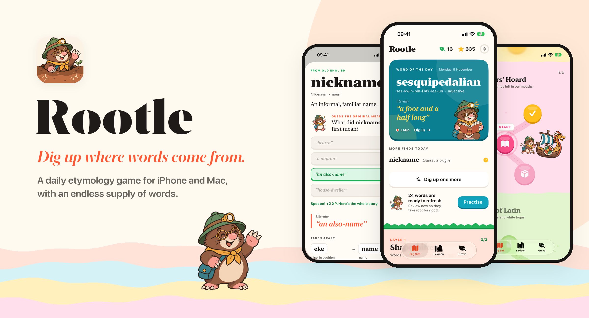
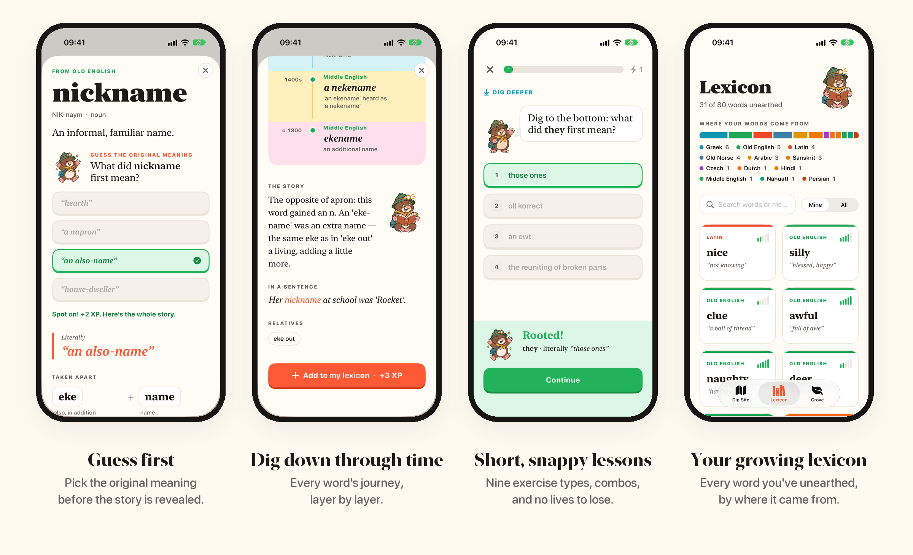
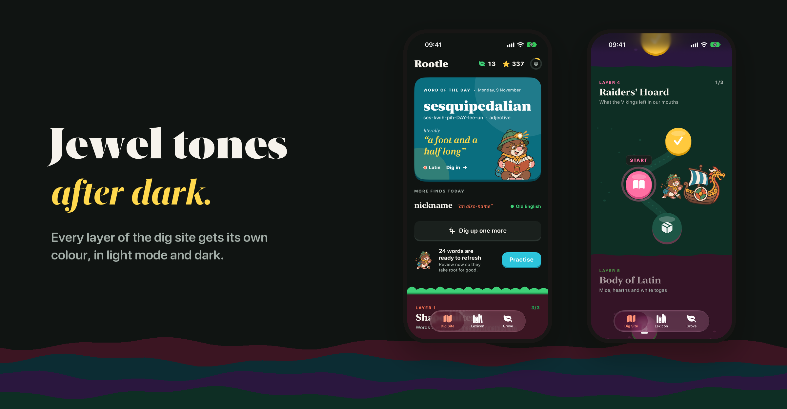
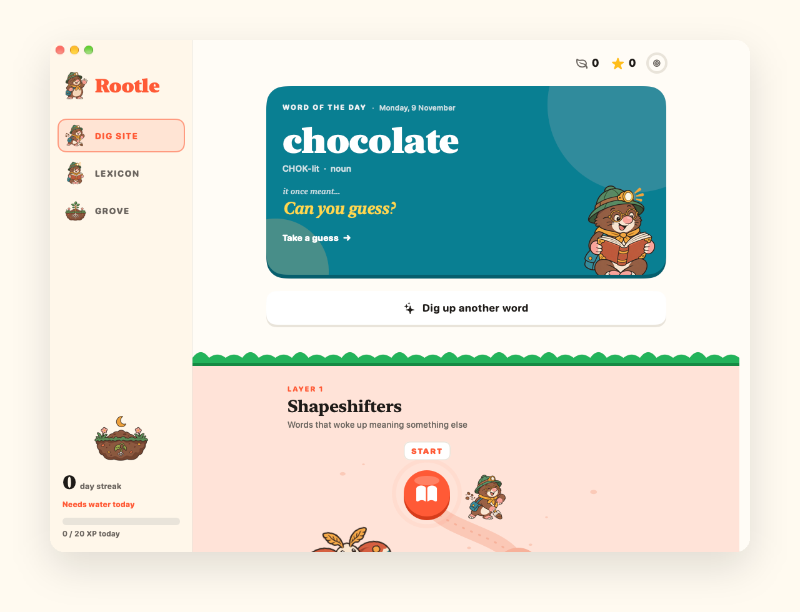
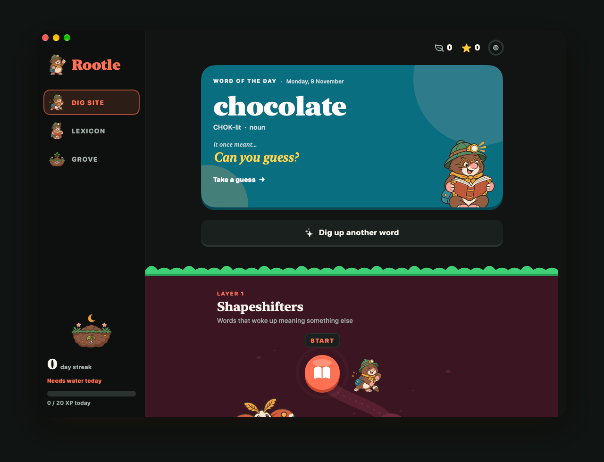

<p align="center">
  
</p>

# Rootle

**Rootle is a daily etymology game for iPhone and Mac.** Every word has a buried history, and Rootle has you dig it up: one surprising word a day, short lessons that teach where words come from, and a mole called Digby who cheers you on.

*Nice* once meant "not knowing". *Nickname* was "an also-name". *Sesquipedalian* is literally "a foot and a half long". Rootle is made of discoveries like these.

<p align="center">
  
</p>

## What's inside

**A dig site instead of a level map.** The learning path runs down through layers of soil. Each layer is a themed set of eight words (Shapeshifters, Gods & Monsters, The Spice Road, Raiders' Hoard and more), with two lessons and a treasure review.

**A word of the day, and as many more as you want.** Before you see a new word's story, you guess what it first meant or which language it came from. A right guess earns +2 XP. Then the whole history appears: what the word literally meant, its parts, and its journey through each earlier language.

**It never runs out.** 80 hand-checked words ship with the app. Beyond those, Claude digs up new themed layers and extra words whenever you want them, and it starts the next layer automatically when you reach the bottom.

**Lessons that teach as you go.** There are nine exercise types: meaning, dig deeper (original meaning), where-from, roots, build-the-word, time travel (put a word's ancestors in order), fact or fib (including popular myths about word origins), match-up and new-word cards. Every answer, right or wrong, shows the word's literal origin. There are no lives to lose. A combo meter rewards streaks of right answers, and anything you miss comes back at the end of the lesson.

**Spaced repetition underneath.** Each word sits in one of five boxes that schedule its next review, and the Lexicon tab shows how well each word has taken root.

**A streak that grows.** The Grove tab shows your streak as a plant growing from a seed to an old oak, along with a weekly XP chart, badges and a daily reminder that names that day's word.

**Widgets.** Word of the Day (small, medium and large, plus the iPhone Lock Screen) and Streak Plant, on iPhone and Mac.

**Sync without a paid account.** Pick the same iCloud Drive folder on each device and your progress and words follow you between them.

<p align="center">
  
</p>

## On the Mac

The Mac app has its own illustrated sidebar, with your streak plant and today's XP always in view. ⌘1, ⌘2 and ⌘3 switch sections.

<p align="center">
  
  
</p>

## Build it

Requirements: Xcode 16 or later, iOS 18 / macOS 15, and [XcodeGen](https://github.com/yonaskolb/XcodeGen).

```bash
xcodegen generate
open Rootle.xcodeproj
```

Pick the **Rootle-iOS** or **Rootle-macOS** scheme. To build it under your own Apple account, change `DEVELOPMENT_TEAM` and the `dev.davidsaint.rootle` bundle and app-group identifiers in `project.yml`. Then run `xcodegen generate` again.

### Word generation (optional)

New words come from the Claude API (`claude-opus-5-5`; see `App/Engine/WordForge.swift`). To turn it on:

```bash
export ANTHROPIC_API_KEY=...   # or keep it in ~/.zsh_secrets
./scripts/write_secrets.sh
```

This writes the key into the git-ignored `Config/Secrets.xcconfig`, which is built into the app's Info.plist. Without a key, Rootle still works with its 80 built-in words.

The key ships inside the app bundle, so this setup is meant for building Rootle for your own devices. Don't distribute a build that contains your key.

## How it works

| | |
|---|---|
| **Content** | Bundled words live in `Shared/Resources/lexicon-*.json`. Generated words are saved to `generated-lexicon.json` in the app group container, so the widgets can read them. Claude's output is constrained to a JSON schema, so it drops straight into the same format. |
| **Word of the day** | Each day's word is fixed once it's shown, so the lexicon can grow without reshuffling past days. New picks come from words you haven't seen yet. |
| **Sync** | Grove → Sync with iCloud Drive → Choose folder. Each device writes only its own `progress-<device>.json` and `words-<device>.json` and reads everyone else's, so no device overwrites another. `ProgressState.merged(with:)` combines them: XP is counted per device and added up, streaks come from the days you were active on any device, each word keeps its most-practised review state, and *Reset progress* wins over anything older. |
| **Art** | Illustrations were generated with OpenAI's image model through Codex and live in `art/raw`. Run `python3 scripts/build_assets.py` to rebuild the asset catalog and app icons. |

### Debug flags

These only work in Debug builds:

- `-seedDemo` fills in about two weeks of sample progress.
- `-clearDemo` wipes this device's progress without affecting synced devices.
- Mac only: `-snapshot` renders each screen in light and dark and prints them as base64 PNGs, and `-forgeTest` generates one real layer and prints it.
